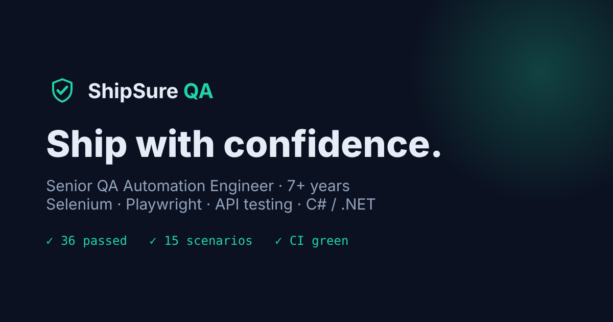

### Hi, I'm Nagarasu 👋 · Senior QA Automation Engineer · AI-powered QA

I help engineering teams **release faster with confidence** by combining test automation with **Generative AI and Agentic AI**.

- 🧪 **7+ years in QA**: QA Engineer (SDET) → Senior QA Analyst, e-commerce and banking domains
- 🤖 Playwright, Selenium, SpecFlow/Reqnroll (.NET/C#), Java, TypeScript, Python, Cucumber, TestNG, Rest Assured, Postman
- ☁️ Testing .NET / .NET Core / C# Web APIs and Azure services: APIM, Service Bus, Functions, Storage Queues, Key Vault, App Insights, SQL
- 🌍 **Available for freelance projects**: UK, US, Canada, Australia, Europe

### 🧠 What I'm building now
In my current role I build **AI-powered QA agents** with Python, Playwright and Agentic AI, using Claude integrated into VS Code. The agents:
- Analyse Jira requirements and acceptance criteria
- Decide the right scope: smoke, functional or regression
- Trigger Playwright automation and analyse the results
- Generate HTML reports and post results back to Jira

Current projects: **PHP to .NET migration testing** and **.NET 8 to .NET 10 upgrade testing**.

### 🛠️ Tech stack

### 📂 Featured projects
> Self-initiated demo projects against public practice apps. Every one runs in CI on each push, with a live test report.

| Project | What it shows | Status | Live report |
|---|---|---|---|
| [**selenium-java-cucumber**](https://github.com/ShipSureQA/selenium-java-cucumber) | Cucumber BDD, Page Object Model, parallel TestNG, Chrome + Firefox |  | [View →](https://shipsureqa.github.io/selenium-java-cucumber/) |
| [**playwright-ts-e2e**](https://github.com/ShipSureQA/playwright-ts-e2e) | Playwright fixtures, POM, cross-browser + mobile, ESLint gate |  | [View →](https://shipsureqa.github.io/playwright-ts-e2e/) |
| [**api-tests**](https://github.com/ShipSureQA/api-tests) | Rest Assured + Postman/Newman, schema validation, security tests |  | [View →](https://shipsureqa.github.io/api-tests/) |
| [**azure-dotnet-migration**](https://github.com/ShipSureQA/azure-dotnet-migration) | PHP → .NET 10 migration with parity tests, .NET 8→10 upgrade matrix, Reqnroll BDD, Azure Service Bus / Functions / Storage / Key Vault / App Insights / APIM on emulators |  | [View →](https://shipsureqa.github.io/azure-dotnet-migration/) |
| [**ShipSureQA.github.io**](https://github.com/ShipSureQA/ShipSureQA.github.io) | Portfolio site with its own Playwright + axe accessibility suite |  | [Site →](https://shipsureqa.github.io) |

### 🤝 Work with me

